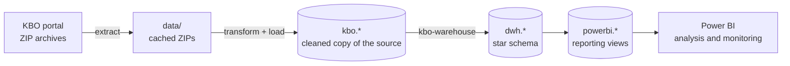
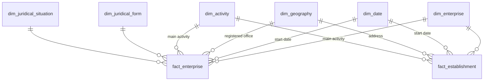

# KBO data warehouse

This document describes the data warehouse built on top of the Belgian Crossroads Bank for
Enterprises open data (KBO/BCE): its goals, its architecture, its model and the data warehousing
concepts it applies. The code is in [`kbo/warehouse.py`](../kbo/warehouse.py).

## 1. Goals and challenges

The `kbo.*` tables mirror the source CSV files: they are normalised, coded
(`juridical_form = '416'`) and organised for loading, not for analysis. Answering "how many
enterprises per region and per sector?" there takes five joins and knowledge of the codes.

The data warehouse aims to:

- **make the data readable**: labels instead of codes, region and province derived from the postal code;
- **make analysis simple and fast**: a star schema that a reporting tool (Power BI) can use directly;
- **give consistent figures**: one definition of "main activity" or "registered office", shared by every report;
- **guarantee traceability**: every refresh records which KBO extract the figures come from.

The associated challenges are data quality (missing values, duplicates), freshness (the source
publishes one update a day), stable identifiers for reports, and performance on 34 million
activity rows.

## 2. Layered architecture



| Layer | Role | Content |
|---|---|---|
| ZIP archives (`data/`) | Raw data, as published | Original CSV files, kept |
| `kbo` schema | Operational data store (ODS) | One table per CSV file, cleaned (see *Transformations* in the README), kept current by `Full` and `Update` extracts |
| `dwh` schema | Presentation layer | Facts and dimensions for reporting |
| `powerbi` schema | Semantic layer | One view per `dwh` table with business names, plus pipeline monitoring views; read by a read-only login |

Each layer has a single responsibility and can be rebuilt entirely from the one before it: the
warehouse can be dropped and recreated without losing anything.

The model follows **Kimball's** dimensional approach (star schemas organised around business
questions) rather than an Inmon-style normalised enterprise warehouse: there is a single source and
the need is reporting, the case where the dimensional approach is the most direct.

## 3. Dimensional model



### Fact tables

The **grain** (what one row represents) is fixed before anything else:

| Table | Grain | Measures |
|---|---|---|
| `fact_enterprise` | one row per active enterprise at the extract date | `enterprise_count` (always 1), `establishment_count`, `has_email`, `has_phone`, `has_website` (0/1), `age_years` |
| `fact_establishment` | one row per establishment unit at the extract date | `establishment_count` (always 1) |

These are **snapshot** facts: they describe the state of the register at the extract date, not
events. The count measures are **additive** (they sum across every dimension); `age_years` is not,
and is analysed as an average or a median. `establishment_number` stays in the fact table as a
**degenerate dimension**: a useful identifier with no other attribute to describe.

### Dimensions

| Dimension | Natural key | Content |
|---|---|---|
| `dim_date` | the date | year, quarter, month, weekday, decade |
| `dim_geography` | postal code + municipality + country | municipality NL/FR, country, province, region |
| `dim_activity` | NACE-BEL 2025 code (5 digits) | NL/FR labels and the hierarchy class (4) → group (3) → division (2) |
| `dim_juridical_form` | juridical form code | NL/FR labels |
| `dim_juridical_situation` | juridical situation code | NL/FR labels |
| `dim_enterprise` | enterprise number | name, type (natural / legal person), status, start date |

`dim_date`, `dim_geography` and `dim_activity` are **conformed dimensions**: both fact tables
share them, so enterprises and establishments can be compared along the same axes.

### Business rules

| Notion | Definition used |
|---|---|
| Location of an enterprise | its registered office address (`REGO`); for an establishment, its own address (`BAET`) |
| Province and region | derived from the 4-digit Belgian postal code; `Abroad` when a country is given |
| Main activity | the activity classified `MAIN` in NACE 2025, truncated to 5 digits; when there are several, the first by activity group then by code |
| Name | the official name (type `001`), in Dutch if it exists, otherwise French, German, English |
| Age | whole years between the start date and the extract date |

## 4. Concepts applied

**Surrogate keys.** Every dimension has its own integer key (`enterprise_key`, `geography_key`, …).
Facts never join on KBO numbers: joins are faster and the model does not depend on the format of
the source identifiers. `dim_date` uses a readable `YYYYMMDD` key.

**Stable keys.** Dimensions are upserted on their natural key, so a member keeps its surrogate key
from one refresh to the next. A report that filtered on a key stays valid.

**Slowly changing dimensions, type 1.** When an attribute changes (an enterprise is renamed), the
new value overwrites the old one and no history is kept. This is the simplest choice and matches
facts that only describe the current state.

**Unknown member.** Every dimension has a row with key `0`. A fact whose attribute is missing
points to it instead of holding `NULL`: inner joins lose no rows and missing values show up
explicitly in reports.

**Referential integrity.** Facts carry foreign keys to the dimensions. They are useful here, unlike
in the `kbo` layer, because the model is ours and the unknown member guarantees they always hold.

**Atomic refresh.** A refresh runs as one transaction: dimensions are updated, facts emptied and
recomputed. A reader sees the old version or the new one, never something in between.

**Traceability.** `dwh.etl_batch` records every refresh: source extract number, snapshot date,
duration and row count per table. Together with `kbo.load_history`, any figure can be traced back
to the ZIP archive it came from.

**Monitoring.** The `powerbi` schema exposes the run history and a set of quality checks
(integrity, reconciliation between layers, update sequence, freshness), shown by the
*KBO Pipeline Health* report: see [powerbi.md](powerbi.md).

## 5. Usage

```bash
# 1. Load or update the kbo layer
kbo --date 2026-11-16

# 2. Refresh the warehouse (and the powerbi views)
kbo-warehouse
```

With Docker: `docker compose run --rm --entrypoint kbo-warehouse kbo`.

On the real data (extract 546) a refresh takes about 2½ minutes and the `dwh` schema takes
817 MB:

| Table | Rows |
|---|---|
| `fact_enterprise` | 1,976,455 |
| `fact_establishment` | 1,711,331 |
| `dim_enterprise` | 1,976,456 |
| `dim_date` | 149,115 |
| `dim_geography` | 61,929 |
| `dim_activity` | 978 |
| `dim_juridical_form` | 147 |
| `dim_juridical_situation` | 41 |

### Example queries

Enterprises and establishments per region:

```sql
SELECT g.region, sum(f.enterprise_count) AS enterprises, sum(f.establishment_count) AS establishments
FROM dwh.fact_enterprise f
JOIN dwh.dim_geography g USING (geography_key)
GROUP BY g.region
ORDER BY enterprises DESC;
```

The five sectors (NACE divisions) with the most enterprises:

```sql
SELECT a.division_code, a.division_label_nl, sum(f.enterprise_count) AS enterprises
FROM dwh.fact_enterprise f
JOIN dwh.dim_activity a ON a.activity_key = f.main_activity_key
WHERE f.main_activity_key <> 0
GROUP BY a.division_code, a.division_label_nl
ORDER BY enterprises DESC
LIMIT 5;
```

Enterprises started per year and juridical form:

```sql
SELECT d.year, jf.label_nl, sum(f.enterprise_count) AS started
FROM dwh.fact_enterprise f
JOIN dwh.dim_date d ON d.date_key = f.start_date_key
JOIN dwh.dim_juridical_form jf USING (juridical_form_key)
WHERE d.year >= 2020
GROUP BY d.year, jf.label_nl
ORDER BY d.year, started DESC;
```

These queries run in 150 to 200 ms on the real data.

### Power BI

Power BI reads the views in the `powerbi` schema with the read-only `powerbi_reader` login, not
the `dwh` tables. Connecting, the model, the measures, a first report and the pipeline health
report are described in [powerbi.md](powerbi.md).

## 6. Data quality in the warehouse

Findings on extract 546, all visible thanks to the unknown member:

| Finding | Count | Explanation |
|---|---|---|
| Enterprises with no location or juridical form | 778,194 | Natural persons: the open data does not publish their address |
| Enterprises with no NACE 2025 main activity | 700,853 | No activity declared, or only in an older version of the classification |
| Establishments with no main activity | 20,174 | Same |
| Establishments with an unknown province | 14 | Irregular Belgian postal code |
| Activity codes missing from the dimension | 0 | |
| Legal persons without a registered office | 0 | Checked on every read of `powerbi."Quality Checks"` |

The `Unknown` region in a report is therefore mostly natural persons; filtering on
`dim_enterprise.enterprise_type_code = '2'` restricts the analysis to legal persons.

## 7. Limits and possible next steps

- **No history.** Facts are recomputed at every refresh and dimensions are type 1. Tracking change
  over time (moves, changes of juridical form) would need type 2 dimensions (one row per version,
  with validity dates) and dated snapshot facts, fed by the daily updates.
- **One activity per enterprise.** Secondary activities are not modelled; a factless
  "entity × activity" fact table (a bridge table) would make them analysable.
- **Full refresh of the facts.** Good enough at this scale; an incremental load from the `Update`
  files would shorten it.
- **NACE sections.** The hierarchy stops at the division: the division → section (letter) mapping
  is not in the source data.
- **Orphaned members.** A struck-off enterprise stays in `dim_enterprise` (with no fact), which
  keeps keys stable.

## 8. Tests

`tests/test_warehouse_db.py` checks, on a small dataset: the grain of the facts, how dimensions
resolve, the NACE hierarchy, the region derived from the postal code, the unknown member,
referential integrity, stable keys and type 1 after an update, and the refresh log.
`tests/test_powerbi_db.py` checks the `powerbi` views (business and monitoring) and the read-only
login.

```bash
python -m pytest tests/test_warehouse_db.py tests/test_powerbi_db.py
```
