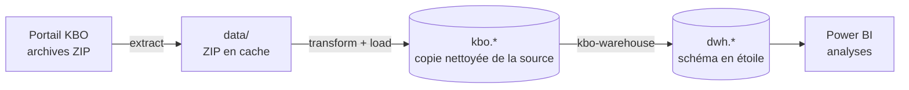
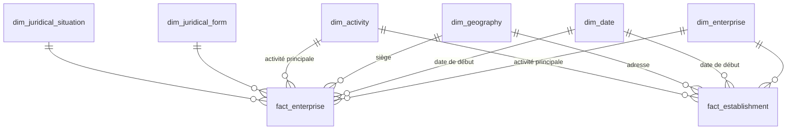

# Datawarehouse KBO

Ce document décrit le datawarehouse construit au-dessus des données de la Banque-Carrefour des
Entreprises (KBO/BCE) : ses objectifs, son architecture, son modèle et les concepts de
datawarehousing qu'il met en pratique. Le code se trouve dans [`kbo/warehouse.py`](../kbo/warehouse.py).

## 1. Objectifs et enjeux

Les tables `kbo.*` reproduisent les fichiers CSV de la source : elles sont normalisées, codées
(`juridical_form = '416'`) et organisées pour le chargement, pas pour l'analyse. Répondre à
« combien d'entreprises par région et par secteur ? » y demande cinq jointures et la connaissance
des codes.

Le datawarehouse a pour objectif de :

- **rendre les données lisibles** : libellés à la place des codes, région et province déduites du code postal ;
- **rendre les analyses simples et rapides** : un modèle en étoile, directement exploitable par un outil de reporting (Power BI) ;
- **donner des chiffres cohérents** : une seule définition de « l'activité principale » ou du « siège », partagée par tous les rapports ;
- **garantir la traçabilité** : chaque rafraîchissement indique de quel extrait KBO proviennent les chiffres.

Les enjeux associés sont la qualité des données (valeurs manquantes, doublons), la fraîcheur
(la source publie une mise à jour par jour), la stabilité des identifiants pour les rapports, et
la performance sur 34 millions de lignes d'activités.

## 2. Architecture en couches



| Couche | Rôle | Contenu |
|---|---|---|
| Archives ZIP (`data/`) | Données brutes, telles que publiées | Fichiers CSV d'origine, conservés |
| Schéma `kbo` | Zone de stockage opérationnelle (ODS) | Une table par fichier CSV, nettoyée (voir *Transformations* dans le README), tenue à jour par les extraits `Full` et `Update` |
| Schéma `dwh` | Couche de présentation | Faits et dimensions pour le reporting |

Chaque couche a une seule responsabilité, et une couche se reconstruit entièrement à partir de la
précédente : le datawarehouse peut être supprimé et recréé sans rien perdre.

Le modèle suit l'approche dimensionnelle de **Kimball** (schémas en étoile orientés vers les
questions métier) plutôt qu'un entrepôt d'entreprise normalisé à la Inmon : la source est unique
et le besoin est le reporting, un cas où l'approche dimensionnelle est la plus directe.

## 3. Modèle dimensionnel



### Tables de faits

Le **grain** (ce que représente une ligne) est fixé avant tout le reste :

| Table | Grain | Mesures |
|---|---|---|
| `fact_enterprise` | une ligne par entreprise active à la date de l'extrait | `enterprise_count` (toujours 1), `establishment_count`, `has_email`, `has_phone`, `has_website` (0/1), `age_years` |
| `fact_establishment` | une ligne par unité d'établissement à la date de l'extrait | `establishment_count` (toujours 1) |

Ce sont des faits de type **instantané** (*snapshot*) : ils décrivent l'état du registre à la date
de l'extrait, pas des événements. Les mesures de comptage sont **additives** (elles se somment sur
toutes les dimensions) ; `age_years` ne l'est pas et s'analyse en moyenne ou en médiane.
`establishment_number` est conservé dans la table de faits comme **dimension dégénérée** : un
identifiant utile, sans autre attribut à décrire.

### Dimensions

| Dimension | Clé naturelle | Contenu |
|---|---|---|
| `dim_date` | la date | année, trimestre, mois, jour de semaine, décennie |
| `dim_geography` | code postal + commune + pays | commune NL/FR, pays, province, région |
| `dim_activity` | code NACE-BEL 2025 (5 chiffres) | libellés NL/FR et hiérarchie classe (4) → groupe (3) → division (2) |
| `dim_juridical_form` | code de forme juridique | libellés NL/FR |
| `dim_juridical_situation` | code de situation juridique | libellés NL/FR |
| `dim_enterprise` | numéro d'entreprise | dénomination, type (personne physique / morale), statut, date de début |

`dim_date`, `dim_geography` et `dim_activity` sont des **dimensions conformes** : les deux tables
de faits les partagent, ce qui permet de comparer entreprises et établissements sur les mêmes axes.

### Règles de gestion

| Notion | Définition retenue |
|---|---|
| Lieu d'une entreprise | adresse du siège (`REGO`) ; pour un établissement, son adresse (`BAET`) |
| Province et région | déduites du code postal belge à 4 chiffres ; `Abroad` si un pays est renseigné |
| Activité principale | activité classée `MAIN` en NACE 2025, ramenée à 5 chiffres ; en cas de plusieurs, la première par groupe d'activité puis par code |
| Dénomination | dénomination officielle (type `001`), en néerlandais si elle existe, sinon français, allemand, anglais |
| Âge | années entières entre la date de début et la date de l'extrait |

## 4. Concepts appliqués

**Clés de substitution.** Chaque dimension a sa propre clé entière (`enterprise_key`,
`geography_key`…). Les faits ne se joignent jamais sur les numéros KBO : les jointures sont plus
rapides et le modèle ne dépend pas du format des identifiants de la source. `dim_date` utilise une
clé lisible au format `AAAAMMJJ`.

**Clés stables.** Les dimensions sont mises à jour par *upsert* sur leur clé naturelle : un membre
garde sa clé de substitution d'un rafraîchissement à l'autre. Un rapport qui a filtré sur une clé
reste donc valide.

**Dimensions à évolution lente, type 1.** Quand un attribut change (une entreprise change de nom),
la nouvelle valeur remplace l'ancienne ; aucun historique n'est conservé. C'est le choix le plus
simple, cohérent avec des faits qui ne décrivent que l'état courant.

**Membre inconnu.** Chaque dimension contient une ligne de clé `0`. Un fait dont l'attribut manque
pointe vers elle au lieu de porter un `NULL` : les jointures internes ne perdent aucune ligne et
les valeurs manquantes apparaissent explicitement dans les rapports.

**Intégrité référentielle.** Les faits portent des clés étrangères vers les dimensions. Elles
sont utiles ici, contrairement à la couche `kbo`, parce que le modèle est le nôtre et que le
membre inconnu garantit qu'elles sont toujours satisfaites.

**Rafraîchissement atomique.** Un rafraîchissement s'exécute en une seule transaction : les
dimensions sont mises à jour, les faits vidés puis recalculés. Un lecteur voit l'ancienne version
ou la nouvelle, jamais un état intermédiaire.

**Traçabilité.** `dwh.etl_batch` enregistre chaque rafraîchissement : numéro de l'extrait source,
date de l'extrait, durée et nombre de lignes par table. Avec `kbo.load_history`, on peut remonter
d'un chiffre à l'archive ZIP dont il provient.

## 5. Utilisation

```bash
# 1. Charger ou mettre à jour la couche kbo
kbo --date 2026-11-16

# 2. Rafraîchir le datawarehouse
kbo-warehouse
```

Avec Docker : `docker compose run --rm --entrypoint kbo-warehouse kbo`.

Sur les données réelles (extrait 546) le rafraîchissement prend environ 2 min 10 s et le schéma
`dwh` occupe 817 Mo :

| Table | Lignes |
|---|---|
| `fact_enterprise` | 1 976 455 |
| `fact_establishment` | 1 711 331 |
| `dim_enterprise` | 1 976 456 |
| `dim_date` | 149 115 |
| `dim_geography` | 61 929 |
| `dim_activity` | 978 |
| `dim_juridical_form` | 147 |
| `dim_juridical_situation` | 41 |

### Exemples de requêtes

Entreprises et établissements par région :

```sql
SELECT g.region, sum(f.enterprise_count) AS entreprises, sum(f.establishment_count) AS etablissements
FROM dwh.fact_enterprise f
JOIN dwh.dim_geography g USING (geography_key)
GROUP BY g.region
ORDER BY entreprises DESC;
```

Les cinq secteurs (divisions NACE) qui comptent le plus d'entreprises :

```sql
SELECT a.division_code, a.division_label_fr, sum(f.enterprise_count) AS entreprises
FROM dwh.fact_enterprise f
JOIN dwh.dim_activity a ON a.activity_key = f.main_activity_key
WHERE f.main_activity_key <> 0
GROUP BY a.division_code, a.division_label_fr
ORDER BY entreprises DESC
LIMIT 5;
```

Créations d'entreprises par année et par forme juridique :

```sql
SELECT d.year, jf.label_fr, sum(f.enterprise_count) AS creations
FROM dwh.fact_enterprise f
JOIN dwh.dim_date d ON d.date_key = f.start_date_key
JOIN dwh.dim_juridical_form jf USING (juridical_form_key)
WHERE d.year >= 2020
GROUP BY d.year, jf.label_fr
ORDER BY d.year, creations DESC;
```

Ces requêtes s'exécutent en 150 à 200 ms sur les données réelles.

### Power BI

Se connecter à PostgreSQL (`localhost:5432`, base `kbo`) et importer les tables du schéma `dwh`.
Les relations suivent les clés `*_key` ; `start_date_key` et `main_activity_key` sont à relier
manuellement à `dim_date.date_key` et `dim_activity.activity_key`, leurs noms différant.

## 6. Qualité des données dans le datawarehouse

Constats sur l'extrait 546, tous visibles grâce au membre inconnu :

| Constat | Nombre | Explication |
|---|---|---|
| Entreprises sans lieu ni forme juridique | 778 194 | Les personnes physiques : la source ouverte ne publie pas leur adresse |
| Entreprises sans activité principale NACE 2025 | 700 853 | Activité non déclarée, ou seulement dans une version antérieure de la nomenclature |
| Établissements sans activité principale | 20 174 | Idem |
| Établissements à la province inconnue | 14 | Code postal belge irrégulier |
| Codes d'activité absents de la dimension | 0 | |
| Personnes morales sans siège | 0 | |

La région `Unknown` d'un rapport regroupe donc surtout les personnes physiques ; le filtre
`dim_enterprise.enterprise_type_code = '2'` restreint l'analyse aux personnes morales.

## 7. Limites et évolutions possibles

- **Pas d'historique.** Les faits sont recalculés à chaque rafraîchissement et les dimensions sont
  de type 1. Suivre l'évolution dans le temps (déménagements, changements de forme juridique)
  demanderait des dimensions de type 2 (une ligne par version, avec dates de validité) et des
  faits instantanés datés, alimentés par les mises à jour quotidiennes.
- **Une seule activité par entreprise.** Les activités secondaires ne sont pas modélisées ; une
  table de faits sans mesure « entité × activité » (table pont) permettrait de les analyser.
- **Rafraîchissement complet des faits.** Suffisant à cette échelle ; un chargement incrémental à
  partir des fichiers `Update` réduirait la durée.
- **Sections NACE.** La hiérarchie s'arrête à la division : la correspondance division → section
  (lettre) ne figure pas dans les données de la source.
- **Membres orphelins.** Une entreprise radiée reste dans `dim_enterprise` (sans fait associé),
  ce qui préserve la stabilité des clés.

## 8. Tests

`tests/test_warehouse_db.py` vérifie sur un petit jeu de données : le grain des faits, la
résolution des dimensions, la hiérarchie NACE, la région déduite du code postal, le membre
inconnu, l'intégrité référentielle, la stabilité des clés et le type 1 après une mise à jour, et
la journalisation des rafraîchissements.

```bash
python -m pytest tests/test_warehouse_db.py
```
