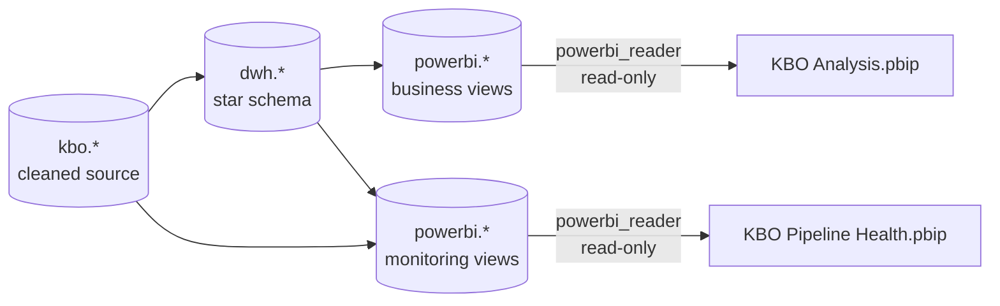

# Power BI with the KBO data warehouse

Two ready-made Power BI projects, in [`powerbi/`](../powerbi):

- **[KBO Analysis](#3-the-analysis-report)**: the star schema as a finished model (relationships,
  measures, hierarchies) with two report pages on Belgian enterprises. Start your own analysis here.
- **[KBO Pipeline Health](#2-the-pipeline-health-report)**: shows the pipeline is working: quality
  checks, loads, warehouse refreshes and row counts.

Open either one, click **Refresh**, enter the read-only login. Nothing to build by hand.

| File | What it is |
|---|---|
| [`kbo/powerbi.py`](../kbo/powerbi.py) | SQL of the `powerbi` views and the read-only login; run by `kbo-warehouse` |
| [`powerbi/KBO Analysis.pbip`](../powerbi/KBO%20Analysis.pbip) | The analysis project: model in `KBO Analysis.SemanticModel/`, pages in `KBO Analysis.Report/` |
| [`powerbi/KBO Pipeline Health.pbip`](../powerbi/KBO%20Pipeline%20Health.pbip) | The health project, same layout |
| [`tests/test_powerbi_db.py`](../tests/test_powerbi_db.py) | The views and the login |
| [`tests/test_powerbi_project.py`](../tests/test_powerbi_project.py) | Both projects only use fields of their model, and each model matches the views |

## 1. How it fits together



Power BI never reads `kbo` or `dwh` directly, only the **`powerbi`** schema:

- **A stable contract:** the warehouse can change underneath without breaking reports, as long as
  the views keep their columns.
- **Readable names:** `geography_key` becomes `"Geography Key"`, `fact_enterprise` becomes
  `"Enterprise Facts"`. A key has the same name on both sides of a relationship.
- **Least privilege:** the `powerbi_reader` login can read these views and nothing else. It cannot
  change data or read the `kbo` and `dwh` schemas.

| View | Role | Rows (extract 546) |
|---|---|---|
| `Enterprise Facts` | Fact: one row per active enterprise | 1,976,455 |
| `Establishment Facts` | Fact: one row per establishment unit | 1,711,331 |
| `Enterprise` | Dimension: number, name, type (natural / legal person) | 1,976,456 |
| `Date` | Dimension: start date (year, quarter, month, decade) | 149,115 |
| `Geography` | Dimension: postal code, municipality, province, region | 61,929 |
| `Activity` | Dimension: NACE 2025 (subclass → class → group → division) | 978 |
| `Juridical Form` | Dimension: juridical form | 147 |
| `Juridical Situation` | Dimension: juridical situation | 41 |
| `Refresh` | The extract and date of the data shown | 1 |
| `Load Runs` | Monitoring: every archive load (`kbo.load_history`) | one per run |
| `Warehouse Refreshes` | Monitoring: every warehouse refresh (`dwh.etl_batch`) | one per refresh |
| `Table Row Counts` | Monitoring: exact row count of every `kbo` and `dwh` table | 16 |
| `Quality Checks` | Monitoring: pipeline checks, evaluated when read | 9 |

`kbo-warehouse` creates the views and the login. The password is `POWERBI_PASSWORD` in `.env`
(and the user name `POWERBI_USER`, default `powerbi_reader`). Without `POWERBI_PASSWORD` no login
is created.

### What a Power BI project is

A `.pbip` file is a pointer to two folders of text files, which Git can diff and review:

| Folder | Format | Holds |
|---|---|---|
| `<name>.SemanticModel/definition/` | TMDL | `tables/*.tmdl`: one file per table, with its columns, measures and the query that loads it; `relationships.tmdl`; `expressions.tmdl`: the `Server` and `Database` parameters |
| `<name>.Report/definition/` | PBIR (JSON) | `pages/<page>/page.json` and one `visuals/<id>/visual.json` per visual, naming the model fields it shows |

Each table loads one view: `PostgreSQL.Database(Server, Database)`, then
`Source{[Schema = "powerbi", Item = "<view>"]}`. Both projects use **Import** mode: the data is
copied into the file on Refresh, so visuals are instant. DirectQuery would query PostgreSQL on every
click: slower, and pointless for data that changes once a day.

### Connecting

Both projects connect to `127.0.0.1:5432`, database `kbo`. The first time, Power BI asks for
credentials:

1. Make sure the database is running: `docker compose up -d`.
2. Choose the **Database** tab and enter `powerbi_reader` and the `POWERBI_PASSWORD` from `.env`.
3. If Power BI reports an encryption problem: the project's PostgreSQL has no TLS certificate.
   Accept the unencrypted connection (or untick *Use encrypted connection*); everything stays on
   this machine.

Power BI remembers the credentials per server, so the second project does not ask again.

> Use `127.0.0.1` rather than `localhost`: on this machine `localhost` resolves to IPv6 (`::1`)
> first, which the Docker port does not serve, and the connection hangs.

To point a project at another server, change the parameters: *Transform data* → *Edit parameters*.

## 2. The pipeline health report

1. Double-click `powerbi/KBO Pipeline Health.pbip`. Power BI Desktop opens the report, empty.
2. Click **Refresh** and enter the credentials (see *Connecting*). Loading takes a few seconds:
   the monitoring views are small.

### Page "Pipeline health"

| Visual | Shows | Healthy when |
|---|---|---|
| Pipeline status | `Healthy`, `Warning` or `Failing`, from the quality checks | `Healthy` |
| Quality checks | checks passed out of checks run | `9 / 9 passed` |
| Database / Warehouse | extract in `kbo` (last successful load) and extract the warehouse was built from | the same number |
| Last load | when the last successful load finished | today or yesterday |
| Failed loads | failed runs in the history | 0 |
| Rows inserted and deleted per update | size of each daily update | a few thousand to a few tens of thousands of rows |
| Update load duration | seconds per update | about one second |
| Quality checks table | every check, its failing rows and status | all `Pass` |
| Rows per table | exact row counts of `kbo` and `dwh` tables | `fact_enterprise` = `enterprise`, `fact_establishment` = `establishment` |

### The quality checks

| Category | Check | Severity |
|---|---|---|
| Integrity | Establishments without an enterprise | Error |
| Integrity | Branches without an enterprise | Error |
| Reconciliation | Enterprises: source (`kbo`) vs warehouse (`dwh`) | Error |
| Reconciliation | Establishments: source vs warehouse | Error |
| Completeness | Legal persons without a registered office | Error |
| Sequence | Updates missing since the last Full load | Error |
| Freshness | Warehouse not built from the current extract | Error |
| Freshness | More than 3 days since the snapshot date | Warning |
| Runs | Failed loads in the last 7 days | Warning |

A check passes when its "Failing Rows" is 0. They are SQL in the `powerbi."Quality Checks"` view
([`kbo/powerbi.py`](../kbo/powerbi.py)), so they can also be queried without Power BI:

```sql
SELECT "Check", "Failing Rows", "Status" FROM powerbi."Quality Checks" ORDER BY "Order";
```

### Page "Run history"

Every archive load (archive, status, extract before and after, rows inserted and deleted,
duration, error) and every warehouse refresh (source extract, snapshot date, duration, fact row
counts).

## 3. The analysis report

1. Double-click `powerbi/KBO Analysis.pbip`.
2. Click **Refresh** and enter the credentials (see *Connecting*). This one imports about 6 million
   rows: allow a few minutes, and a file of a few hundred MB in memory.

### The model

Open **Model view** to see it. Everything below is in the TMDL files, so nothing needs fixing by hand.

- **Ten relationships**, all many-to-one with single direction, from each dimension to the facts:

  | Fact table | Related through its key to |
  |---|---|
  | Enterprise Facts | Enterprise, Date, Geography, Activity, Juridical Form, Juridical Situation |
  | Establishment Facts | Enterprise, Date, Geography, Activity |

  The two facts never relate to each other directly: they meet through the dimensions they share,
  so one slicer on `Geography[Region]` filters both. `Refresh` has no relationship.
- **Key columns are hidden**, and so are the raw fact columns (`Enterprise Count`, `Has Email`, ...):
  they exist for relationships and measures, not to be dragged into visuals.
- **Hierarchies** for drill-down: `Geography[Location]` (region → province → municipality),
  `Activity[NACE NL]` and `[NACE FR]` (division → group → class → activity),
  `Date[Start Date]` (decade → year → quarter → month).
- **Auto date/time is off**: the `Date` table already does that job, and the option would add a
  hidden table per date column.

### The measures

Visuals use measures, never raw numeric columns, so each calculation rule is written once. Each
measure has a description, shown when you hover over it in the Data pane.

| Measure | Table | Definition |
|---|---|---|
| `Enterprises` | Enterprise Facts | Number of active enterprises |
| `Enterprises with Email` | Enterprise Facts | Enterprises with a published e-mail address |
| `Email / Phone / Website Coverage %` | Enterprise Facts | Share of enterprises with that contact channel |
| `Average Age (years)` | Enterprise Facts | Average age at the snapshot date (an average: not additive) |
| `Establishments per Enterprise` | Enterprise Facts | Establishment units per enterprise |
| `Share of Enterprises %` | Enterprise Facts | Share of the current selection |
| `Establishments` | Establishment Facts | Number of establishment units |
| `Data As Of` | Refresh | "KBO extract 546 of 15/11/2026", for traceability |

`Establishments`, filtered by `Geography` or `Activity`, uses the establishment's own address and
activity, not its enterprise's.

### The pages

| Page | Visuals |
|---|---|
| Overview | Data as of; enterprises, establishments, email coverage; enterprises and establishments per region; enterprises per NACE division; active enterprises by decade of start; juridical forms with share and average age |
| Contact coverage | Email, phone and website coverage; per province: enterprises, the three coverages, establishments per enterprise |

Both pages have an **enterprise type** slicer, and it matters: the `Unknown` region (about 778,000
enterprises) is the **natural persons**, whose address the source does not publish. Selecting
*Rechtspersoon* (legal person) gives a map of companies without that bias.

## 4. Changing a report

Edit it in Power BI Desktop and **save** (keep the `.pbip` format): the project files are rewritten
and the change shows up in `git diff`. Add pages and visuals freely; a new measure or column goes
into the model files the same way.

If you add a column to a view in `kbo/powerbi.py`, add it to the model too (*Transform data* →
*Refresh preview*, or edit the table's `.tmdl`): `test_powerbi_project.py` fails while a model and
its view disagree.

Power BI also writes a `.pbi/` folder with local settings and the data cache; it is ignored by
[`powerbi/.gitignore`](../powerbi/.gitignore).

## 5. Refreshing

The data follows the chain:

```bash
docker compose run --rm kbo --type Update                # 1. new extract into kbo.*
docker compose run --rm --entrypoint kbo-warehouse kbo   # 2. dwh.* and the powerbi.* views
```

then **Refresh** in Power BI (3). The health report shows whether each step worked: *Database* and
*Warehouse* show the same extract once both have run. A warehouse refresh is one transaction: a
Power BI refresh that starts during it waits for it to finish, then reads the new data.

## 6. Troubleshooting

| Symptom | Cause and fix |
|---|---|
| The connection hangs, then times out | Server `localhost`: use `127.0.0.1:5432` |
| Certificate or encryption error | No TLS on this PostgreSQL: accept the unencrypted connection |
| "password authentication failed" | Run `kbo-warehouse` again after changing `POWERBI_PASSWORD` in `.env`; update the saved credentials in *Data source settings* |
| A table fails to load: "relation does not exist" | `kbo-warehouse` has not run since the view was added |
| The health report says `Failing` | Open the quality checks table: the failing check names what to look at |
| *Database* and *Warehouse* show different extracts | A load ran but `kbo-warehouse` did not: run it, then refresh |
| "permission denied" on `kbo` or `dwh` | Expected: the Power BI login only reads `powerbi` |
